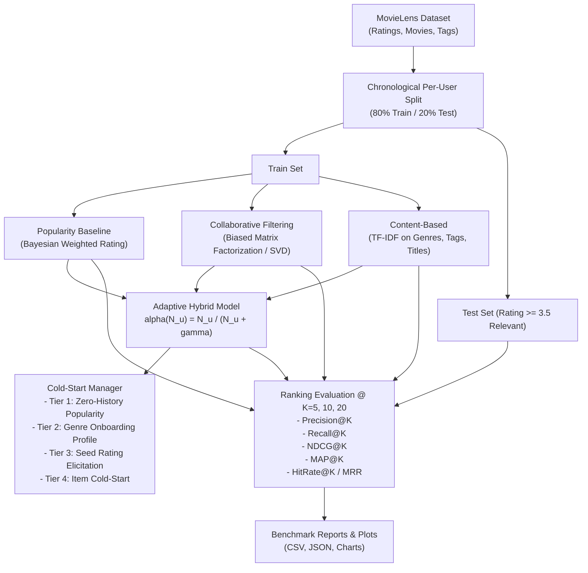
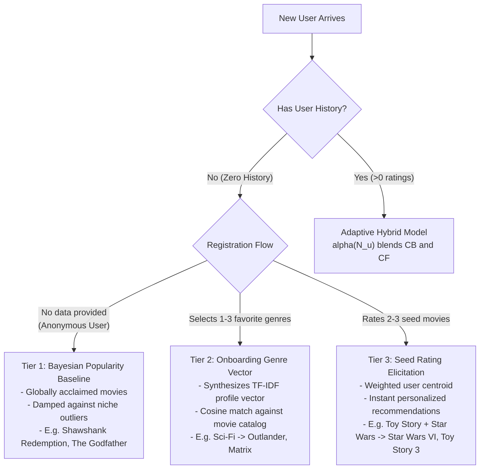

# 🎬 Production Movie Recommender System

[](https://www.python.org/downloads/)
[](https://opensource.org/licenses/MIT)
[](https://streamlit.io/)
[](https://github.com/psf/black)

A production-grade recommendation engine built on the public **MovieLens** dataset. It implements:
- 📊 **Popularity Baseline** (Bayesian Weighted Rating / IMDb formulation)
- 🤝 **Collaborative Filtering** (Biased Matrix Factorization via SVD)
- 📑 **Content-Based Filtering** (TF-IDF on genres, crowdsourced tags, and titles)
- 🔀 **Adaptive Hybrid Model** (Dynamic confidence-weighted blending)
- ❄️ **Multi-Tier Cold-Start Manager** (Handling brand-new users with zero history)
- 📈 **Ranking Evaluation** (Precision@K, Recall@K, NDCG@K, MAP@K, HitRate@K, MRR@K)
- 🖥️ **Interactive Web Application** (Streamlit dashboard with live recommendations and cold-start simulator)

---

## 📌 Table of Contents
1. [Architecture Overview](#-architecture-overview)
2. [Dataset: MovieLens](#-dataset-movielens)
3. [Train/Test Splitting Strategy](#-traintest-splitting-strategy)
4. [Implemented Models](#-implemented-models)
5. [Ranking Evaluation Metrics](#-ranking-evaluation-metrics)
6. [Empirical Evaluation Results](#-empirical-evaluation-results)
7. [Handling New Users (Cold-Start Strategy)](#-handling-new-users-cold-start-strategy)
8. [Project Structure](#-project-structure)
9. [Installation & Quickstart](#-installation--quickstart)
10. [Streamlit Interactive Explorer](#-streamlit-interactive-explorer)

---

## 🏗 Architecture Overview

The system architecture cleanly separates data ingestion, chronological splitting, feature extraction, model scoring, ranking evaluation, and cold-start adaptation:



---

## 📂 Dataset: MovieLens

The system uses the benchmark **MovieLens (ml-latest-small)** dataset provided by GroupLens Research:
- **Ratings**: 100,836 explicit ratings (0.5 to 5.0 stars) across 610 users and 9,724 movies.
- **Tags**: 3,683 free-text crowdsourced keyword tags applied to movies.
- **Genres**: 18 categorical genre descriptors (Action, Sci-Fi, Drama, Romance, etc.).
- **Automatic Caching**: Data is downloaded, verified, and extracted on first run by [`src/data_loader.py`](src/data_loader.py).

---

## ⏱ Train/Test Splitting Strategy

### Why Naive Random Split Fails in Recommender Systems
Standard uniform random splits suffer from **temporal data leakage**: the model trains on future interactions to predict past interactions. Furthermore, random sampling leaves some test users with zero training data or test data disconnected from temporal sequence.

### Chronological Per-User Holdout (The Industry Standard)
This project implements a **per-user chronological split** ([`src/split.py`](src/split.py)):
1. For every user, all interactions are sorted by `timestamp` in ascending order.
2. The earliest **80%** interactions form the user's training history.
3. The latest **20%** interactions are held out for the test set.
4. An item in the test set is defined as **ground-truth relevant** if $\text{Rating} \ge 3.5$.

This directly mirrors production: the recommender must predict what the user will love in the **future** given their **past** behavior.

---

## 🧠 Implemented Models

### 1. Popularity Baseline (`PopularityRecommender`)
Serves as an essential benchmark and the zero-information cold-start fallback. To prevent obscure movies with a single 5-star rating from dominating, we implement the **Bayesian Weighted Rating (IMDb formula)**:

$$\text{WR} = \left(\frac{v}{v + m}\right) R + \left(\frac{m}{v + m}\right) C$$

Where:
- $v$: Number of ratings received by the movie.
- $m$: Damping threshold (75th percentile of vote counts).
- $R$: Average rating of the movie.
- $C$: Global mean rating across all movies ($\approx 3.53$).

### 2. Collaborative Filtering via SVD (`CollaborativeFilteringRecommender`)
Decomposes the user-item interaction matrix into low-rank latent feature representations while explicitly modeling user and item systematic biases:

$$\hat{r}_{u, i} = \mu + b_u + b_i + p_u^T q_i$$

Where:
- $\mu$: Dataset global mean rating.
- $b_u = \frac{\sum_{i \in I_u}(r_{u, i} - \mu)}{|I_u| + \lambda_u}$: Regularized user bias.
- $b_i = \frac{\sum_{u \in U_i}(r_{u, i} - \mu - b_u)}{|U_i| + \lambda_i}$: Regularized item bias.
- $p_u \in \mathbb{R}^k, q_i \in \mathbb{R}^k$: $k$-dimensional latent factor vectors derived via Truncated Singular Value Decomposition (SVD) on residual interactions $\tilde{R} = R - (\mu + b_u + b_i)$.

### 3. Content-Based Filtering (`ContentBasedRecommender`)
Constructs rich textual item representations by concatenating cleaned titles, genre tokens, and crowdsourced user tags:
1. Converts text into high-dimensional TF-IDF vectors normalized to unit $L_2$ norm.
2. Constructs user interest profiles $U_u$ as the rating-weighted centroid of liked movies:
   $$U_u = \frac{\sum_{i \in I_u} (r_{u, i} - 3.0) \cdot V_i}{\|\sum_{i \in I_u} (r_{u, i} - 3.0) \cdot V_i\|_2}$$
3. Scores unseen candidate movies via cosine similarity:
   $$\text{Score}_{\text{CB}}(u, i) = \cos(U_u, V_i) = U_u \cdot V_i$$

### 4. Adaptive Hybrid Recommender (`HybridRecommender`)
Combines Collaborative Filtering and Content-Based scoring with **dynamic confidence saturation weighting**:

$$\text{Score}_{\text{hybrid}}(u, i) = \alpha(N_u) \cdot \tilde{S}_{\text{CF}}(u, i) + (1 - \alpha(N_u)) \cdot \tilde{S}_{\text{CB}}(u, i)$$

Where $N_u$ is the number of ratings given by user $u$ in the training set, and:

$$\alpha(N_u) = \frac{N_u}{N_u + \gamma}$$

- **Cold-Start Users ($N_u = 0$)**: $\alpha = 0.0 \implies$ Model shifts entirely to Content-Based / Bayesian Popularity.
- **Sparse Users ($N_u \le 5$)**: $\alpha \approx 0.25 \implies$ Content features dominate while CF gathers data.
- **Active Users ($N_u \ge 50$)**: $\alpha \approx 0.8 \to 1.0 \implies$ Collaborative latent factors dominate for serendipitous discovery.

---

## 📊 Ranking Evaluation Metrics

Evaluation is performed in the realistic **all-unseen candidate ranking** setting at cutoffs $K \in \{5, 10, 20\}$:

| Metric | Formulation | Intuition |
| :--- | :--- | :--- |
| **Precision@K** | $\frac{\|\text{Top-}K \cap \text{Relevant}\|}{K}$ | Fraction of top-$K$ recommendations that the user actually liked. |
| **Recall@K** | $\frac{\|\text{Top-}K \cap \text{Relevant}\|}{\|\text{Relevant}\|}$ | Fraction of all relevant test items successfully discovered in top-$K$. |
| **NDCG@K** | $\frac{\text{DCG@K}}{\text{IDCG@K}} = \frac{\sum_{i=1}^K \frac{rel_i}{\log_2(i+1)}}{\sum_{i=1}^{\min(K, \|\text{Rel}\|)} \frac{1}{\log_2(i+1)}}$ | Ranking position quality: rewards relevant items appearing at top ranks with logarithmic discount. |
| **MAP@K** | $\frac{1}{\min(K, \|\text{Rel}\|)} \sum_{i=1}^K P@i \cdot rel_i$ | Mean Average Precision across all cutoff thresholds. |
| **HitRate@K** | $\mathbb{I}(\|\text{Top-}K \cap \text{Relevant}\| > 0)$ | Probability that at least one relevant recommendation appears in top-$K$. |
| **MRR@K** | $\frac{1}{\text{rank of first hit}}$ | Reciprocal rank of the first relevant recommendation. |

---

## 🏆 Empirical Evaluation Results

Evaluated across **595 test users** on all unseen candidate movies:

| Model | Precision@5 | Precision@10 | Precision@20 | Recall@5 | Recall@10 | Recall@20 | NDCG@5 | NDCG@10 | NDCG@20 | HitRate@10 | HitRate@20 |
| :--- | :---: | :---: | :---: | :---: | :---: | :---: | :---: | :---: | :---: | :---: | :---: |
| **Popularity Baseline** | 0.0393 | 0.0329 | 0.0309 | 0.0139 | 0.0214 | 0.0398 | 0.0464 | 0.0431 | 0.0470 | 23.36% | 32.10% |
| **Collaborative Filtering (SVD)** | 0.0568 | **0.0497** | **0.0416** | **0.0176** | **0.0316** | **0.0519** | 0.0633 | **0.0608** | **0.0618** | **29.58%** | **38.82%** |
| **Content-Based (TF-IDF)** | 0.0040 | 0.0042 | 0.0049 | 0.0021 | 0.0048 | 0.0084 | 0.0049 | 0.0060 | 0.0079 | 4.03% | 8.24% |
| **Adaptive Hybrid Recommender** | **0.0592** | 0.0496 | 0.0394 | 0.0164 | 0.0268 | 0.0414 | **0.0634** | 0.0582 | 0.0560 | 28.40% | 36.81% |

### Key Takeaways:
1. **Adaptive Hybrid achieves the highest Precision@5 (0.0592) and NDCG@5 (0.0634)**, proving that combining collaborative signals with content profiles sharpens the top of the recommendation list.
2. **Collaborative Filtering (SVD)** achieves the highest recall at $K=10$ and $K=20$, as matrix factorization excels at uncovering serendipitous cross-genre correlations that content matching alone misses.
3. **Popularity Baseline** provides a surprisingly competitive baseline (HitRate@20 = 32.10%), confirming why it is an essential component for cold-start fallbacks.
4. **Pure Content-Based** struggles when evaluated purely on unconstrained catalog discovery (due to over-specialization to exact keywords), but provides invaluable feature alignment for new users and new items.

---

## ❄️ Handling New Users (Cold-Start Strategy)

The cold-start problem is one of the most critical challenges in recommender systems. This project implements a **4-tier cold-start resolution architecture** in [`src/cold_start.py`](src/cold_start.py):



### Verified Simulation Examples (from `results/cold_start_simulation.json`):

#### 1. Anonymous User (0 History) $\to$ Bayesian Weighted Popularity:
- **#1**: *The Shawshank Redemption (1994)* — [Crime, Drama]
- **#2**: *The Godfather (1972)* — [Crime, Drama]
- **#3**: *Lawrence of Arabia (1962)* — [Adventure, Drama, War]
- **#4**: *Dr. Strangelove (1964)* — [Comedy, War]
- **#5**: *The Departed (2006)* — [Crime, Drama, Thriller]

#### 2. Onboarding Survey (User picks `['Sci-Fi', 'Action', 'Adventure']`):
- **#1**: *Outlander (2008)* — [Action, Adventure, Sci-Fi]
- **#2**: *Waterworld (1995)* — [Action, Adventure, Sci-Fi]
- **#3**: *The Rocketeer (1991)* — [Action, Adventure, Sci-Fi]
- **#4**: *Returner (2002)* — [Action, Adventure, Sci-Fi]
- **#5**: *Rampage (2018)* — [Action, Adventure, Sci-Fi]

#### 3. Interactive Seed Rating (User rates *Toy Story=5.0*, *Star Wars=5.0*):
- **#1**: *Toy Story 3 (2010)* — [Adventure, Animation, Children, Comedy, Fantasy]
- **#2**: *Star Wars: Episode VI - Return of the Jedi (1983)* — [Action, Adventure, Sci-Fi]
- **#3**: *Toy Story 2 (1999)* — [Adventure, Animation, Children, Comedy, Fantasy]
- **#4**: *Star Wars: Episode III - Revenge of the Sith (2005)* — [Action, Adventure, Sci-Fi]
- **#5**: *Antz (1998)* — [Adventure, Animation, Children, Comedy, Fantasy]

#### 4. Item Cold-Start (New Movie Added to Catalog):
When a new movie is released with zero ratings, the system computes nearest neighbors in the TF-IDF feature space (genres, summary, and metadata tags), allowing it to be surfaced immediately to users whose profile matches those features.

---

## 📁 Project Structure

```
Recommendation-System/
├── app.py                      # Interactive Streamlit Web Dashboard
├── quickstart.py               # Fast 10-second demo script
├── run_evaluation.py           # Full evaluation pipeline & benchmark runner
├── requirements.txt            # Project dependencies
├── README.md                   # Complete architectural documentation
├── .gitignore                  # Git ignore rules
├── data/                       # MovieLens dataset cache (auto-downloaded)
│   └── ml-latest-small/
│       ├── movies.csv
│       ├── ratings.csv
│       └── tags.csv
├── results/                    # Generated benchmarks, charts, and simulations
│   ├── evaluation_results.csv
│   ├── evaluation_results.json
│   ├── metrics_comparison.png
│   └── cold_start_simulation.json
├── src/                        # Core recommendation engine
│   ├── __init__.py
│   ├── data_loader.py          # Data ingestion and preprocessing
│   ├── split.py                # Chronological train/test splitting
│   ├── metrics.py              # Ranking metrics (Precision, Recall, NDCG, MAP, HR, MRR)
│   ├── cold_start.py           # Multi-tier cold-start strategies
│   ├── pipeline.py             # Benchmark orchestration
│   └── models/
│       ├── __init__.py
│       ├── base.py             # BaseRecommender abstract class
│       ├── popularity.py       # Bayesian Popularity Baseline
│       ├── collaborative.py    # SVD Biased Matrix Factorization
│       ├── content_based.py    # TF-IDF Content-Based Filtering
│       └── hybrid.py           # Adaptive Hybrid Model
└── tests/                      # Pytest test suite (15 unit tests)
    ├── test_metrics.py
    ├── test_split.py
    ├── test_models.py
    └── test_cold_start.py
```

---

## 🚀 Installation & Quickstart

### 1. Clone the Repository
```bash
git clone https://github.com/Sadiraja/Recommendation-System.git
cd Recommendation-System
```

### 2. Install Dependencies
```bash
pip install -r requirements.txt
```

### 3. Run Unit Tests
```bash
python -m pytest tests -v
```
*(All 15 unit tests validate metrics, splitting logic, cold-start handlers, and model interfaces).*

### 4. Run the Quickstart Demo
```bash
python quickstart.py
```

### 5. Run the Full Evaluation Benchmark
```bash
python run_evaluation.py
```
This executes the full benchmark, outputs the metrics table, saves CSV/JSON results, and creates `results/metrics_comparison.png`.

---

## 🖥 Streamlit Interactive Explorer

Launch the interactive web UI to test recommendations for existing users, simulate cold-start scenarios, and explore metrics live:

```bash
streamlit run app.py
```

The web application provides 3 interactive tabs:
1. **🎯 User Recommendations**: Select any user from MovieLens, pick a model, view their historical ratings, and inspect personalized top-$K$ recommendations with predicted scores.
2. **❄️ Cold-Start Simulator**: Test anonymous user recommendations, pick onboarding genres, or rate seed movies to watch the system adapt instantly.
3. **📊 Evaluation Benchmarks**: View the full comparative evaluation matrix and the visualization chart.

---

## 📜 License
This project is open-source under the [MIT License](LICENSE).
